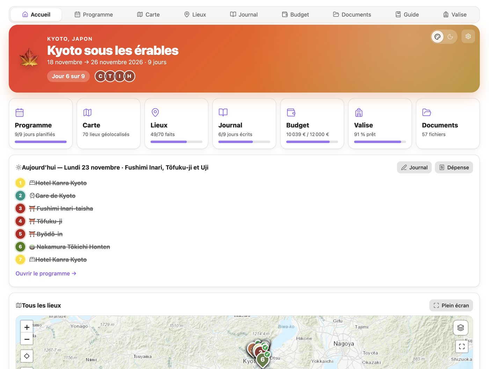
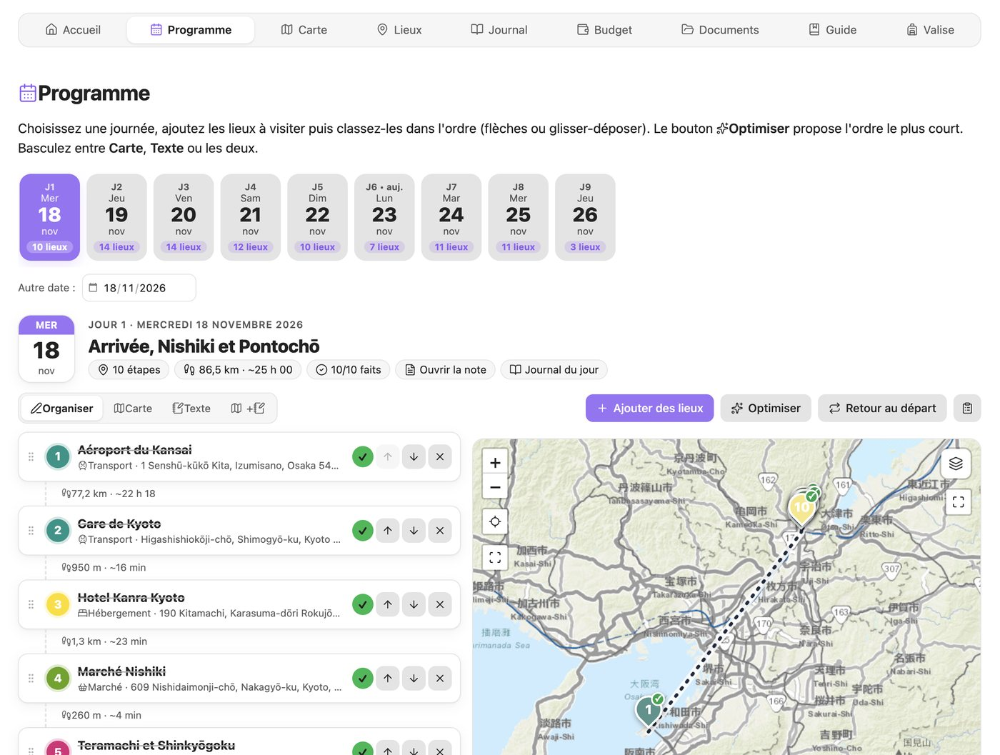
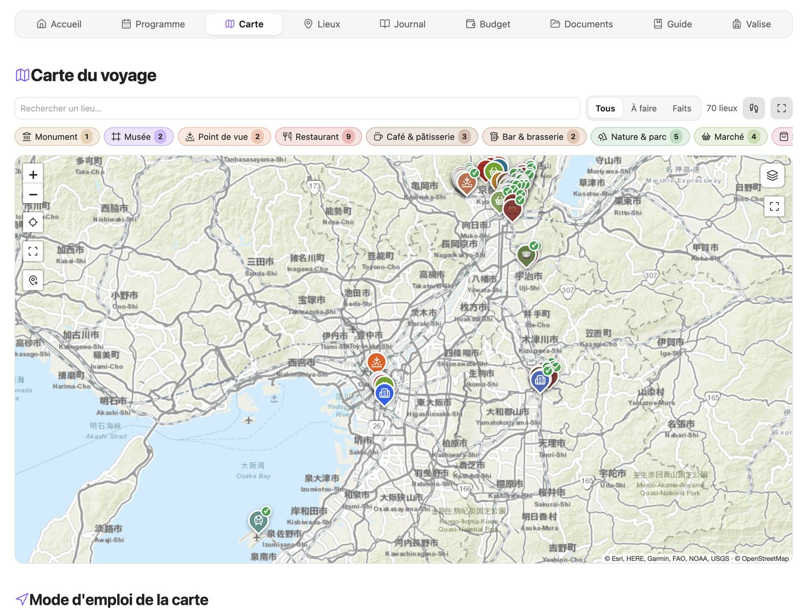
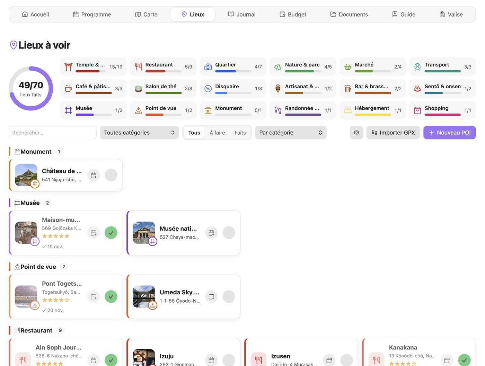
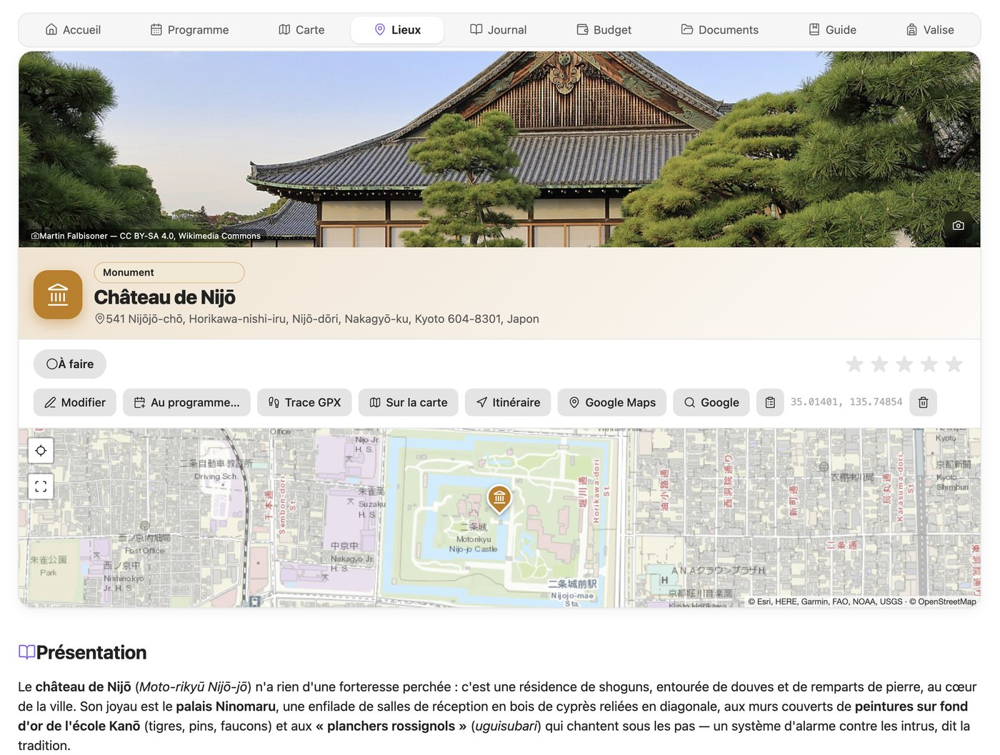
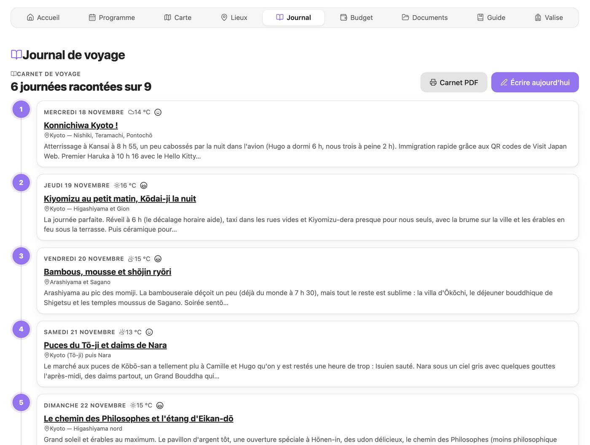
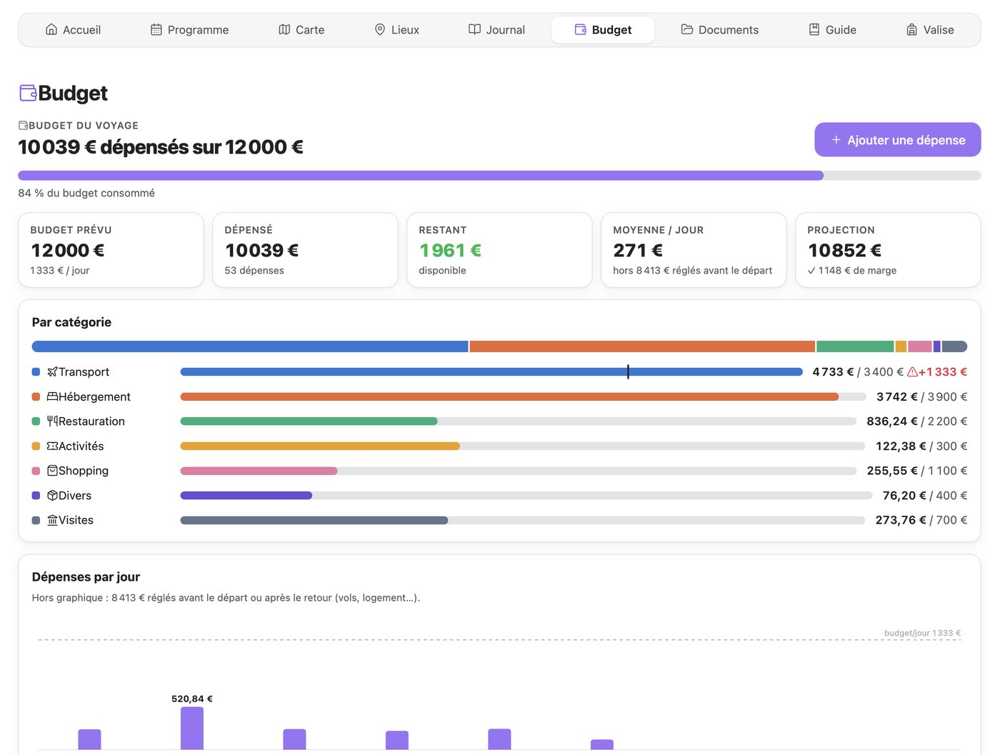
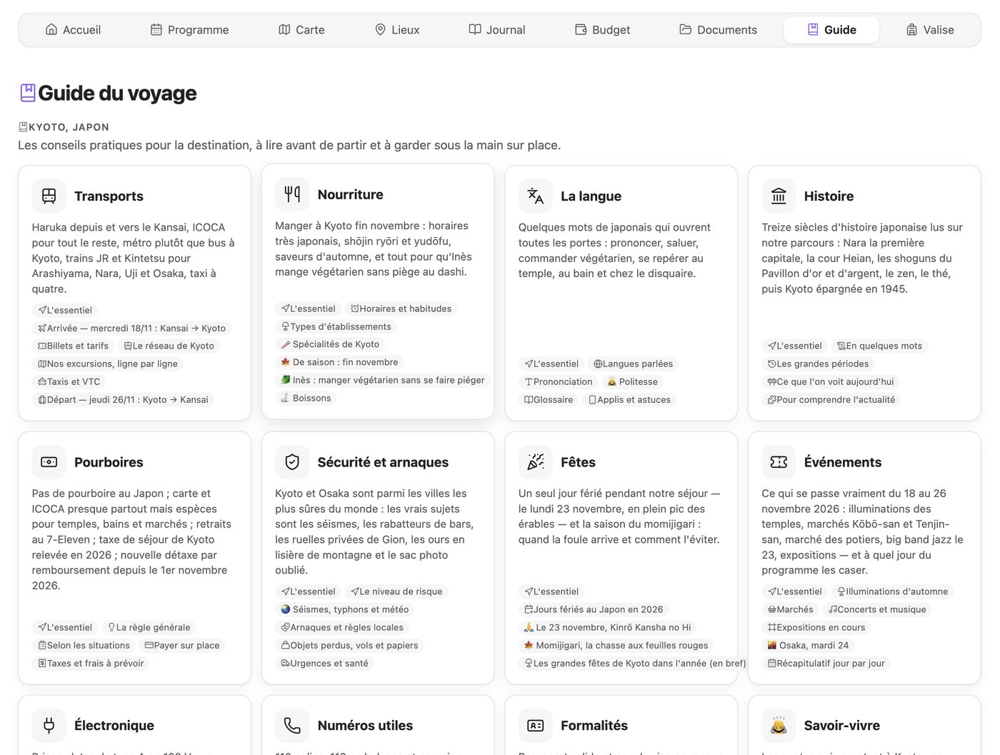

# 🧭 Mode d'emploi de Trip Buddy

Ce coffre est un **modèle de voyage** : dupliquez-le pour chaque nouveau voyage. Tout est piloté par le module **Trip Buddy** (plugin inclus dans `.obsidian/plugins/trip-buddy`, version 1.2.4, Obsidian 1.4 ou plus récent, bureau **et** mobile).

Il rassemble dans un seul coffre : les lieux à voir (POI géocodés), une carte OpenStreetMap, le programme jour par jour, le journal, le budget partagé, la valise, les documents, un guide de la destination, et produit deux PDF : un **carnet souvenir** imprimable et un **export complet** du voyage.

> [!example] Voyage d'exemple
> Le coffre contient un voyage complet et fictif (« Kyoto sous les érables », 18 → 26 novembre 2026, à quatre amis) : 70 lieux, 9 programmes, 6 entrées de journal, un budget, un guide et des documents. Servez-vous-en pour découvrir le module, puis videz-le (voir [[#🧳 Nouveau voyage|Nouveau voyage]]).

## 📸 Aperçu
*Captures du voyage d'exemple, thème clair.*



| | |
| --- | --- |
|  |  |
| **🗓️ Programme** : étapes ordonnées, temps de trajet, itinéraire sur la carte | **🗺️ Carte** : tous les lieux, filtres par catégorie et statut |
|  |  |
| **📍 Lieux** : progression par catégorie, recherche, filtres | **🏛️ Fiche d'un lieu** : photo, statut, note, actions, mini-carte, guide |
|  |  |
| **📔 Journal** : frise des journées, météo, humeur, carnet PDF | **💰 Budget** : dépensé, restant, projection, répartition par catégorie |
|  | |
| **📚 Guide** : pages pratiques et culturelles sur la destination | |

---

## 🚀 Démarrage
**Télécharger** : chaque version est publiée, prête à l'emploi, sur la page [Releases](https://github.com/blamouche/obsidian-trip-buddy/releases/latest) du dépôt. Téléchargez `trip-buddy-vX.Y.Z.zip`, décompressez-le, puis dans Obsidian choisissez *Ouvrir un dossier comme coffre* → dossier **Trip Buddy**. Les nouveautés de chaque version sont dans [[CHANGELOG]].

**Mettre à jour** : quand une nouvelle version est publiée, un **panneau 🆕 au-dessus du menu principal** l'annonce sur toutes les pages (bouton **⬇️ Mettre à jour**, lien *Nouveautés*, ✕ pour le masquer jusqu'à la version suivante ; désactivable dans *Réglages → Affichage des notes*). Le numéro de version et l'état des mises à jour sont aussi affichés en haut de **Réglages → Trip Buddy**. La mise à jour remplace, après confirmation :
- le module Trip Buddy (`.obsidian/plugins/trip-buddy`, sauf `data.json`) ;
- les skills IA livrés (`.claude/skills/travel-context` et `travel-planner`) — vos autres skills ne sont pas touchés.

Les **contenus ne sont jamais modifiés** : notes, documents, journal, budget, valise, guide, `CONTEXT.md`, réglages (`trip-buddy.json`). Chaque fichier téléchargé est vérifié (taille et empreinte SHA-256) avant toute écriture ; la version en place est d'abord copiée dans la corbeille du coffre (`.trash/trip-buddy-<version>-<date>/`) et remise en place si l'écriture échoue. Le module se recharge tout seul à la fin. La mise à jour automatique est disponible à partir de la 1.2.0 ; pour une version plus ancienne, remplacez à la main le dossier `.obsidian/plugins/trip-buddy` (et `.claude/skills`) par ceux du paquet, puis désactivez / réactivez Trip Buddy.

**Version de développement** : à chaque mise à jour de la branche `main`, un paquet `trip-buddy-vX.Y.Z-dev.N-<commit>.zip` est construit et publié en *pré-version* sur la page [Releases](https://github.com/blamouche/obsidian-trip-buddy/releases) (une seule à la fois). Il contient les nouveautés pas encore publiées : à réserver aux tests.

1. Ouvrez le coffre puis, si Obsidian le demande, **faites confiance à l'auteur** et activez les plugins communautaires (Réglages → Plugins communautaires → *Trip Buddy* activé).
2. Ouvrez [[00 Accueil]] : c'est le tableau de bord du voyage (il s'ouvre aussi tout seul au démarrage).
3. Réglez le voyage dans **Réglages → Trip Buddy** (ou ⚙️ sur l'accueil) : nom, destination, emoji, dates, voyageurs, devise, budget, catégories…

Deux icônes sont ajoutées dans le ruban de gauche : 🗺️ **carte du voyage** (plein écran) et ✈️ **accueil du voyage**.

## 🧳 Nouveau voyage
1. Dupliquez le dossier du coffre (ou synchronisez-en une copie) et ouvrez-le dans Obsidian.
2. Lancez la commande **« Trip Buddy : Vider les données d'exemple (nouveau voyage) »** (ou le bouton en bas des réglages). ⚠️ **L'effacement est définitif** : à la fin, la corbeille du coffre (`.trash`) est entièrement vidée, y compris ce qu'elle contenait avant. Exportez ou sauvegardez d'abord ce que vous voulez garder (carnet, export PDF…). Après confirmation :
   - **tout le contenu** des dossiers Documents, Journal, POI, Programme et Guide est effacé : billets, PDF, photos, traces GPX, entrées de journal, programmes, fiches de lieux (même sans propriété `type`), pages de guide ajoutées ; les sous-dossiers devenus vides aussi. Seules les pages d'accueil des rubriques (Documents, Journal, Index des POI, Programme, Guide) et les modèles restent ;
   - le tableau des dépenses est vidé et la valise entièrement décochée ;
   - les pages de base du guide repartent d'un squelette vierge et les sections libres propres au voyage (*Notes rapides* de l'accueil, *Idées en vrac* du programme) sont vidées, en gardant intertitres et en-têtes de tableau (une copie de chaque page modifiée passe par `.trash`, qui est vidée ensuite) ;
   - le contexte du voyage (`CONTEXT.md`) et le dossier de travail `.trip-planner`, créés par les skills Claude `travel-context` et `travel-planner`, sont effacés aussi ;
   - les réseaux de transports en commun sont retirés (fichiers dans `.trash`, liste des réglages vidée) et les cartes hors ligne **de cet appareil** sont supprimées (elles sont stockées par appareil : sur un autre appareil, utiliser *Tout supprimer* dans les réglages des cartes hors ligne) ;
   - le voyage est renommé **« My trip »** avec l'emoji 🧳, ses participants, sa destination, ses dates, son budget et les budgets par catégorie sont remis à zéro, la couverture du carnet oubliée (devise et autres réglages conservés).
   - **enfin, la corbeille du coffre `.trash` est vidée définitivement** (si elle ne peut pas l'être, le message l'indique et les fichiers y restent).
   > ⚠️ Avec un plugin de synchronisation (Remotely Save…), synchronisez juste après le nettoyage et vérifiez que les autres appareils suivent : sinon une copie distante peut faire revenir les anciens fichiers.
3. Mettez à jour les réglages du voyage (la fenêtre des réglages s'ouvre automatiquement), puis chargez le réseau de transports et téléchargez les cartes hors ligne de la nouvelle destination.

---

## 🗂️ Organisation du coffre
| Dossier / page | Contenu |
| --- | --- |
| `00 Accueil.md` | Tableau de bord du voyage + section « Notes rapides ». |
| `01 Documents` | Billets, réservations, PDF, photos, rangés en sous-dossiers (`Administratif`, `Hébergement`, `Réservations`, `Transport`…). `Photos` reçoit les images collées dans les notes (et `Photos/POI` les photos des lieux), `Traces` les GPX importés, `Transports` les réseaux de transports en commun. Les PDF générés (carnet, export) y sont aussi enregistrés. |
| `02 Journal` | Une note par jour (`AAAA-MM-JJ.md`) + la page Journal (frise). |
| `03 Budget` | Le tableau des dépenses + le tableau de bord. |
| `04 Packing` | La liste de bagages (cases à cocher Markdown). |
| `05 POI` | Une note par lieu (propriétés + descriptif / guide) + l'index des lieux. |
| `06 Programme` | Une note par journée planifiée (`Programme AAAA-MM-JJ.md`) + le planificateur. |
| `07 Carte` | La carte OpenStreetMap de tous les lieux. |
| `08 Guide` | Le guide de la destination : transports, nourriture, langue, histoire, pourboires, sécurité, numéros utiles, formalités… et vos pages ajoutées. |
| `CHANGELOG.md` | Journal des versions : nouveautés et corrections de chaque version. |
| `docs/screenshots` | Captures d'écran utilisées par ce mode d'emploi (sans effet sur le module). |
| `99 Modèles` | Modèles de notes (POI, journal, programme) et de valises (`Packing - City trip`, `Packing - Plage`, `Packing - Randonnée`). Les notes de ce dossier sont ignorées par le module. |

Tous ces emplacements se changent dans *Réglages → Trip Buddy → Dossiers et pages*. Les marque-pages d'Obsidian donnent un accès direct aux pages principales.

La **barre de navigation** en haut de chaque page (bloc `tripbuddy-nav`) mène aux rubriques : 🏠 Accueil · 🗓️ Programme · 🗺️ Carte · 📍 Lieux · 📔 Journal · 💰 Budget · 📁 Documents · 📚 Guide · 🎒 Valise (ordre modifiable et rubriques masquables dans les réglages). La rubrique de la page courante est mise en évidence.

---

## 🏠 Accueil (tableau de bord)
- **En-tête** : emoji, destination, nom et dates du voyage (nombre de jours), statut (à venir / en cours / terminé), avatars des voyageurs, accès aux réglages ⚙️ et sélecteur de thème 🎨 / 🌙. Le **dégradé de fond reprend les couleurs de l'emoji du voyage** (🇮🇹 rouge → vert, 🌸 rose, ✈️ bleu…), assombries pour que le texte reste lisible, et en version plus sombre avec le thème 🌙 ; un emoji sans couleur (⚫, 🐘…) garde le dégradé par défaut.
- **Bandeau « Voyage d'exemple »** (tant que `demo` vaut `true` dans `trip-buddy.json`, c'est le cas du coffre téléchargé) : rappelle que le voyage est fictif, avec un bouton **🧹 Repartir de zéro** qui ouvre directement la section *Préparer un nouveau voyage* des réglages. *Masquer ce message* le retire sans rien effacer ; *Vider les données d'exemple* le retire aussi.
- **Tuiles** avec progression : jours planifiés, lieux géolocalisés, lieux faits, jours écrits dans le journal, budget dépensé / prévu, valise prête (%), nombre de documents. Ctrl/Cmd + clic ouvre dans un nouvel onglet.
- **Journée en cours** (aujourd'hui pendant le voyage, sinon le prochain jour ou le premier) : étapes du programme, boutons ✍️ Journal et 💸 Dépense, ou 🗓️ *Planifier la journée* si rien n'est prévu.
- **Carte de tous les lieux** avec l'itinéraire du jour, bouton ⛶ plein écran.
- **Notes rapides** : section libre sous le tableau de bord, modifiable en mode lecture (voir [[#✍️ Saisie rapide en mode lecture|Saisie rapide]]).

## 📍 Lieux (POI)
### Index des lieux
Recherche, filtre par catégorie et par statut (tous / à faire / faits), tri (par catégorie, note, date de visite, nom), statistiques par catégorie (faits / total). Chaque ligne montre la photo, l'adresse, la note ★, la trace GPX éventuelle, la date de visite, ⚠︎ si le lieu n'a pas de coordonnées, un bouton 📅 (ajouter au programme) et une case ✓ (fait / à faire).

Boutons : ⚙️ catégories, 🥾 **Importer GPX**, ＋ **Nouveau POI**.

### Créer / modifier un lieu
Fenêtre **＋ Nouveau POI** (commande *Nouveau point d'intérêt*, bouton de l'index, bouton ＋ de la carte ou clic droit / appui long sur la carte) :
- nom, catégorie, note (0 à 5 ★), statut (à faire / fait) et date de visite ;
- **adresse** : 📍 *Géocoder* recherche l'adresse sur OpenStreetMap (Nominatim) et calcule les coordonnées ; à l'inverse, un point posé sur la carte retrouve son adresse ;
- **photo d'illustration** (copiée dans `01 Documents/Photos/POI`, avec son crédit) ;
- **trace GPX** et sa couleur (optionnel).

En mode *Modifier*, la note est renommée si le nom change.

### Fiche d'un lieu (bloc `tripbuddy-poi`)
Photo de couverture (📷 pour la changer, crédit affiché), catégorie modifiable directement, adresse, bouton **✅ Fait / ⬜ À faire** avec la date de visite, note ★, jours où le lieu est **au programme**. Actions :
✏️ Modifier · 📅 Au programme… · 📷 Photo · 🥾 Trace GPX · 🗺️ Sur la carte · 🧭 Itinéraire · *Ouvrir dans* (Google Maps, OSM ou votre service) · 🔎 Google · 📋 copier les coordonnées · 🗑 supprimer (le lieu est aussi retiré des programmes).
En dessous : mini-carte du lieu (ou de sa trace), puis le texte libre de la note (*Présentation*, *Infos pratiques*, *Mes notes*).

### Propriétés d'un POI
```yaml
type: poi            # obligatoire
name: Park Güell
category: nature     # identifiant d'une catégorie des réglages
address: "Carrer d'Olot, 08024 Barcelone, Espagne"
lat: 41.414235
lon: 2.152458
done: true
done_date: 2026-11-22
rating: 4            # 0 à 5
photo: "[[Park Güell.jpg]]"
photo_credit: "essetefano — CC BY 3.0, Wikimedia Commons"
gpx: "[[Promenade.gpx]]"   # trace GPX (ou liste de traces)
track_color: "#6d4c9f"     # couleur de la trace (sinon celle de la catégorie)
tags: [poi]
```
Le champ `location: [lat, lon]` (format du plugin Map View) est aussi reconnu. À l'import d'une trace, le résumé est recopié dans `distance_km`, `ele_gain`, `ele_loss`, `ele_max` et `duration` (pour les tris et requêtes) ; la fiche, elle, recalcule tout depuis le fichier GPX.

**Catégories du voyage d'exemple** : 🏛️ Monument · 🖼️ Musée · 🌅 Point de vue · 🍽️ Restaurant · ☕ Café & pâtisserie · 🍺 Bar & brasserie · 🌳 Nature & parc · 🏖️ Plage · 🧺 Marché · 🛍️ Shopping · 🏘️ Quartier · 🛏️ Hébergement · 🚉 Transport · 🎵 Disquaire · 🥾 Randonnée & balade.

> [!info] Où sont les propriétés ?
> Elles sont **masquées dans les notes** pour alléger l'affichage (option *Masquer les propriétés en tête des notes* des réglages, ou commande *Afficher / masquer les propriétés des notes*). Les champs courants (statut, date, note, catégorie) se modifient directement depuis la fiche du lieu, le reste via ✏️ *Modifier*, le panneau « Propriétés du fichier » ou le mode source.

## 🗺️ Carte
Page **Carte**, vue plein écran (icône du ruban ou commande *Ouvrir la carte du voyage*) et mini-cartes de l'accueil, des fiches et des programmes. Les lieux apparaissent en pastilles à l'emoji et à la couleur de leur catégorie.
- **◎** se localiser (suivi en direct ; le navigateur demande l'autorisation) · **⤢** recentrer sur les lieux affichés · **⛶** plein écran.
- **＋** puis toucher la carte (ou clic droit / appui long) : *Nouveau lieu ici ?* → créer un POI, l'adresse est retrouvée automatiquement.
- **🗺️** changer de fond de carte : OpenStreetMap, OSM France, OpenTopoMap, Satellite (Esri), Topographique (Esri), CyclOSM (vélo), OSM Humanitaire — tous sans clé d'API.
- **🥾** afficher / masquer les traces GPX · **🚇** afficher / masquer métro, tram et funiculaires.
- Filtres par catégorie et par statut au-dessus de la carte.
- **Bulle d'un lieu** : catégorie, statut, adresse, note, et boutons 📄 Ouvrir · 📅 Au programme… · ✏️ · ✓ Fait / ↺ À faire · 🧭 Y aller.

## 🗓️ Programme
- **Planificateur** (page Programme, bloc `tripbuddy-planner`) : un bandeau de jours (J1, J2…, aujourd'hui mis en évidence, nombre de lieux prévus) et un champ *Autre date* pour planifier avant / après le voyage. *＋ Créer le programme* crée la note du jour depuis le modèle.
- **Éditeur d'itinéraire** (bloc `tripbuddy-program`, dans chaque note `Programme AAAA-MM-JJ`) :
  - vues **✏️ Organiser**, **🗺️ Carte**, **📝 Texte** ou **🗺️ + 📝** (mémorisée) ;
  - **＋ Ajouter des lieux** (sélecteur avec recherche), réordonner par flèches ou glisser-déposer, retirer une étape ; les étapes déjà faites sont signalées « ✓ fait » ;
  - **✨ Optimiser** : ordre le plus court (plus proche voisin + 2-opt), en gardant le retour au départ en dernier ;
  - **🔁 Retour au départ** : ajoute la première étape en fin de journée (retour à l'hôtel) ;
  - **📋** copie l'itinéraire en Markdown (étapes, distances, temps de marche) ;
  - résumé : nombre d'étapes, distance et temps de marche estimés, étapes faites ; liens vers la note et le journal du jour.
- Depuis une fiche, la carte ou l'index : **📅 Au programme…** ajoute le lieu à la fin d'une journée (avant le retour au départ s'il y en a un).
- Section **📝 Notes & réservations** de chaque programme : texte libre (horaires, réservations…), modifiable en mode lecture.

Propriétés d'une note de programme : `type: programme`, `date`, `title`, `pois` (liste ordonnée de liens `[[Lieu]]`).

## 📔 Journal
- **Page Journal** (bloc `tripbuddy-journal`) : frise de toutes les journées du voyage (météo, humeur, lieu, photo, extrait) ; *＋ Écrire* pour un jour pas encore raconté ; boutons **✍️ Écrire aujourd'hui** et **🖨️ Carnet PDF**.
- **Entrée du jour** (`AAAA-MM-JJ.md`, créée depuis le modèle par *Journal du jour* ou par la frise) — en-tête `tripbuddy-journal-day` :
  - jour *n* sur *N*, titre, lieu ;
  - **météo** (fenêtre de choix : pictogramme, température, commentaire) et **humeur** 😞 → 😄 en un clic ;
  - **photo du jour** (📷 ajouter / changer, ✕ retirer) ;
  - **lieux faits ce jour-là** (POI marqués faits à cette date) et **dépenses du jour** ;
  - navigation ◀ jour précédent · 🗓️ Programme du jour · 📔 Tout le journal · jour suivant ▶.
- Sections du modèle : *Résumé de la journée*, *Ce qu'on a fait*, *Où on a mangé*, *Ressentis & anecdotes*, *Photos*.

Propriétés : `type: journal`, `date`, `title`, `location`, `weather` (ex. `🌤️ 18 °C`), `mood` (1 à 5), `cover` (lien vers une image).

## ✍️ Saisie rapide en mode lecture
Option *Saisie rapide* des réglages (activée par défaut). Sans passer en mode édition :
- **zone d'ajout** sous chaque section (`##`) des entrées de journal, des *Notes rapides* de l'accueil, des *Idées en vrac* du planificateur, des *Notes & réservations* des programmes et de *Mes notes* des fiches de lieux — Ctrl/Cmd + Entrée pour ajouter, Échap pour annuler ;
- bouton **📷** pour ajouter une ou plusieurs photos à la section (copiées dans le dossier des pièces jointes) ;
- chaque paragraphe ou élément de liste peut être **modifié** ou **supprimé** en place.

## 💰 Budget
- **Tableau de bord** (bloc `tripbuddy-budget`) :
  - total dépensé / budget, % consommé ;
  - indicateurs : budget prévu (et par jour), dépensé, restant, moyenne par jour sur place, **projection** de fin de voyage ;
  - répartition **par catégorie** avec budget prévu et dépassements ⚠︎ ;
  - graphique des **dépenses par jour** (les dépenses réglées avant le départ ou après le retour sont mises à part) ;
  - **Qui a payé quoi ?** : ce que chaque voyageur a payé et ce qu'il doit / doit recevoir (partage égal des dépenses dont le payeur est renseigné) ;
  - dernières dépenses (option `recent`), cliquables pour les modifier.
- **＋ Ajouter une dépense** (ou commande *Nouvelle dépense*, ou 💸 sur l'accueil) : montant, devise, catégorie, libellé, date, payé par, note. La dernière devise et le dernier payeur sont mémorisés.
- Le tableau **🧾 Dépenses** de `Budget.md` est la source des données, modifiable à la main (montant avec virgule ou point, tri chronologique automatique) :

```markdown
| Date | Libellé | Catégorie | Montant | Devise | Payé par | Note |
| --- | --- | --- | ---: | --- | --- | --- |
| 2026-11-21 | Dej Parada Torres | Restauration | 39,90 | EUR | Camille |  |
```
- Devises étrangères : converties dans la devise principale avec les taux des réglages.

## 🎒 Valise
Bloc `tripbuddy-packing` au-dessus de la liste Markdown (`## Catégorie` puis `- [ ] élément`) :
- progression globale et par catégorie ;
- **＋ Ajouter** (plusieurs éléments d'un coup, dans une catégorie existante ou nouvelle) ;
- **📋 Modèle** : importe une note de `99 Modèles` dont le nom contient « Packing » (seuls les éléments absents sont ajoutés, dans les bonnes catégories) ;
- **🙈 Masquer / 👁 Afficher les cochés**, **↺ Tout décocher** (pratique pour le retour) ;
- bouton **✕** sur chaque élément en mode lecture pour le supprimer.

## 📁 Documents
Bloc `tripbuddy-documents` (option `folder`) :
- documents classés **par sous-dossier** de `01 Documents` (cartes avec aperçu des images, type et taille) ; clic pour ouvrir (PDF et images dans Obsidian, le reste avec l'application du système) ;
- **⬆️ Ajouter des fichiers** dans le dossier choisi ;
- **glisser-déposer** une carte sur un autre dossier pour la déplacer (les liens des notes sont mis à jour) ;
- **📄 Exporter le voyage** (voir plus bas).

Les numéros utiles et les formalités sont dans le guide (pages 📞 *Numéros utiles* et 🛂 *Formalités*) ; la page Documents y renvoie.

## 📚 Guide de la destination
- Page **Guide** (bloc `tripbuddy-guide`) : une carte par page de conseils, avec son résumé et ses rubriques. Les pages encore vides sont marquées *À compléter*.
- **Pages de base** : 🚇 Transports, 🍽️ Nourriture, 🗣️ La langue (avec glossaire), 🏛️ Histoire, 💶 Pourboires, 🛡️ Sécurité et arnaques, 📞 Numéros utiles (urgences, consulat, banque et assurance, contacts sur place), 🛂 Formalités (papiers, santé, assurances, douane). Le voyage d'exemple ajoute 🎉 Fêtes, Événements et Électronique. Ce sont des notes normales dans `08 Guide`, à rédiger librement.
- **Ajouter** : bouton *＋ Nouvelle page* (icône + titre), ou *Créer les pages manquantes* si l'une d'elles a été supprimée (commande *Créer les pages du guide de voyage*).
- **Ordre et apparence** : propriétés de chaque page :
  ```yaml
  type: guide
  guide: histoire     # identifiant (pages de base)
  order: 4
  icon: "🏛️"
  summary: "Les grandes périodes et ce qu'elles ont laissé sur notre parcours."
  ```
- En tête de chaque page, une barre (bloc `tripbuddy-guide` avec `mode: pager`) permet de passer d'une page du guide à l'autre.

---

## 🥾 Traces GPX
- **Importer** : bouton *🥾 Importer GPX* de l'index des lieux, bouton 🥾 au-dessus de la carte, ou commande *Importer une trace GPX (nouveau lieu)*. Avec un seul fichier, la fenêtre du lieu s'ouvre avec **toutes les propriétés** pré-remplies : nom de la trace, catégorie *Randonnée & balade* (créée si besoin), point de départ (coordonnées + adresse retrouvée), statut *Fait* et date si la trace a été enregistrée (horodatage), description, note, photo, crédit, couleur de la trace. Avec plusieurs fichiers, un lieu est créé par trace.
- **Associer à un lieu existant** : bouton *🥾 Trace GPX* de la fiche (ou champ « Trace GPX » de la fenêtre *Modifier*). Le bouton ＋ de la fiche ajoute une autre trace au même lieu.
- **Fiche du lieu** : carte de la trace (départ, arrivée, points de passage), distance, dénivelés, altitude min/max, durée (et temps en mouvement) ou temps de marche estimé (DIN 33466), profil altimétrique — survolez-le pour suivre la position sur la carte.
- **Carte** : les traces des lieux affichés sont tracées à la couleur de leur catégorie (ou `track_color`) ; elles suivent les filtres. Le bouton 🥾 de la carte (ou *Réglages → Carte*) les masque.
- **Carnet PDF** : traces sur la carte générale et sur les cartes des journées, profil altimétrique en fin de journée.
- Les fichiers sont copiés dans `01 Documents/Traces` (fonctionne hors ligne). Formats lus : traces (`trk`), itinéraires (`rte`) et points de passage (`wpt`) de tout GPX (Komoot, Strava, Garmin, Visorando, OsmAnd…).

## 🚇 Transports en commun
- **Charger une ville** : *Réglages → Trip Buddy → Transports en commun*. Choisissez une grande ville dans la liste (Paris, Lyon, Barcelone, Madrid, Lisbonne, Rome, Londres, Berlin, New York, Tokyo…) ou *Autre ville…* pour en chercher une autre, puis **Télécharger**. Rien n'est téléchargé avant ce choix.
- **Contenu** : lignes de métro (y compris métro léger), de tram et de funiculaire avec leurs couleurs officielles, et leurs stations. Données OpenStreetMap (API Overpass), enregistrées en JSON compact dans `01 Documents/Transports` : la carte les affiche ensuite hors ligne. *Voyage d'exemple : Barcelone, 23 lignes (14 métro, 6 tram, 3 funiculaires), 209 stations.*
- **Sur la carte** : le bouton 🚇 masque ou réaffiche les réseaux. Les stations de correspondance apparaissent à partir d'un zoom moyen, toutes les stations en zoomant davantage. Survolez une ligne (terminus) ou une station (lignes desservies).
- **Gérer** : chaque réseau chargé peut être masqué (interrupteur), mis à jour depuis OpenStreetMap (🔁) ou supprimé (🗑️, le fichier part dans la corbeille du coffre).

## 📥 Cartes hors ligne
*Réglages → Trip Buddy → Cartes hors ligne* : choisissez une zone (**lieux du voyage**, une ville, ou la **dernière carte affichée**), un fond de carte et un niveau de détail (zoom 13 à 16), puis **Télécharger**. L'estimation du nombre de tuiles et de la taille s'affiche avant de lancer.
- Les tuiles sont gardées **sur l'appareil** (IndexedDB, pas dans le coffre ni la synchronisation) : lancez le téléchargement sur chaque téléphone / ordinateur, de préférence en Wi-Fi.
- Toutes les cartes (pages, fiches, plein écran, création de lieu) lisent d'abord ce cache ; sans réseau, au-delà du zoom téléchargé, les tuiles disponibles sont agrandies.
- Chaque zone peut être mise à jour (↻) ou supprimée (🗑) ; « Lieux du voyage » se recalcule avec les lieux ajoutés depuis. L'espace utilisé est affiché.
- Par respect des conditions d'usage d'OpenStreetMap : zoom 16 au plus, 2 tuiles à la fois, 20 000 tuiles maximum par zone.

---

## 🖨️ Carnet souvenir imprimable
Bouton **🖨️ Carnet PDF** sur la page Journal (ou commande *Générer le carnet souvenir (PDF imprimable, livret A6)*). Le PDF est enregistré dans `01 Documents` sous le nom « Carnet de voyage - … ».

- **Contenu** : couverture (photo), « le voyage en bref », une partie par journée (titre, lieu, météo, humeur, photo de couverture, textes et photos du journal, lieux visités avec leur note), index de tous les lieux visités, pages « Notes » pour compléter, 4ᵉ de couverture.
- **Options du compositeur** (mémorisées d'une fois sur l'autre) :
  - *Couverture* : titre, photo (automatique, sans photo, ou au choix parmi les photos du journal, des lieux ou du coffre), destination, dates, voyageurs ;
  - *Contenu* : « le voyage en bref », **carte des lieux visités** (fond OpenStreetMap, pastilles numérotées et itinéraire de chaque journée), **traces GPX** des lieux visités (tracées sur les cartes, distance et D+ sous le nom du lieu), index des lieux, pages « Notes », texte de 4ᵉ de couverture ;
  - *Journées* : date, lieu, météo, humeur, photo de la journée, textes, photos, lieux visités, programme prévu, carte de chaque journée, profil altimétrique des traces GPX ;
  - *Infos des lieux* : catégorie, note, adresse, date de visite ;
  - *Police* : Classique (Times), Élégante (EB Garamond), Moderne (Source Sans 3) ou Manuscrite (Kalam). Les polices sont dans `.obsidian/plugins/trip-buddy/fonts` (licence SIL OFL).
- La carte demande une connexion Internet au moment de la génération.
- **Format** : livret A6 imposé **in-quarto** — 8 pages par feuille A4 recto-verso, rangée du haut tournée à 180°, traits de coupe et repère de pli. Format fini : 99 × 138,5 mm.

### Impression et montage
1. Imprimer en **recto-verso, retournement sur le bord long**, à la **taille réelle (100 %)**.
2. Plier chaque feuille en deux, **le haut vers l'arrière**, puis encore en deux, **la moitié gauche vers l'arrière** : la page 1 apparaît sur le dessus.
3. **Emboîter** les cahiers : la feuille 2 dans la feuille 1, la 3 dans la 2…
4. **Agrafer** deux fois dans le pli du dos (piqûre à cheval, agrafeuse à bras long).
5. **Massicoter** la tête, le pied et la gouttière en suivant les traits de coupe.

## 📄 Export du voyage en PDF
Bouton **📄 Exporter le voyage** de la page Documents (ou commande *Exporter le voyage en PDF*, ou réglages). Un seul **PDF A4** avec couverture et **sommaire cliquable**, enregistré dans `01 Documents` sous le nom « Export du voyage - … » (remplacé à chaque export).
- **Sections** (le nombre d'éléments est indiqué) : programme jour par jour, lieux visités (groupés par jour de visite, dans l'ordre du programme), journal, carte des lieux visités (connexion requise), photos du voyage, budget (synthèse par catégorie et détail des dépenses), documents joints (les PDF du coffre reproduits en annexe).
- **Options** : sommaire, propriétés des notes (adresse, note, météo…), photos dans les lieux et le journal, inclure aussi les lieux non visités, chaque lieu sur une nouvelle page.
- **Police** : les mêmes que le carnet. Bouton *↺ Options par défaut*.
- Ne sont pas exportés : les pages de documentation du coffre (accueil, mode d'emploi, guide, valise, modèles), ni les PDF produits par Trip Buddy (carnets, exports précédents). Les PDF protégés par mot de passe sont signalés et ignorés.

---

## 🧩 Blocs disponibles
Chaque page est une note Markdown normale dans laquelle on insère un bloc de code :

| Bloc | Rôle | Options |
| --- | --- | --- |
| `tripbuddy-dashboard` | Accueil du voyage | `height` (carte, 340 par défaut) |
| `tripbuddy-nav` | Barre de navigation | — (ordre et rubriques affichées : *Réglages → Trip Buddy → Menu principal*) |
| `tripbuddy-map` | Carte des POI | `height`, `category`, `status` (todo/done), `programme` (date), `tracks: false` (sans traces GPX), `transit: false` (sans transports en commun) |
| `tripbuddy-pois` | Index des POI | `category`, `status` |
| `tripbuddy-poi` | Fiche d'un lieu | `poi` (lien vers une autre note), `map: false`, `track: false`, `height` |
| `tripbuddy-planner` | Choix de la date + programme | — |
| `tripbuddy-program` | Éditeur d'itinéraire d'une journée | `date` |
| `tripbuddy-budget` | Tableau de bord budget | `recent` (nombre de lignes, 8 par défaut) |
| `tripbuddy-packing` | Progression de la valise | `file` |
| `tripbuddy-journal` | Frise du journal | — |
| `tripbuddy-journal-day` | En-tête d'une journée | — |
| `tripbuddy-documents` | Explorateur de documents | `folder` |
| `tripbuddy-guide` | Index du guide (cartes des pages) | `mode: pager` (barre de pages, en tête de chaque page du guide) |

Exemple : une carte limitée aux restaurants pas encore testés
````
```tripbuddy-map
category: restaurant
status: todo
height: 400
```
````

Les classes CSS `tb-page`, `tb-wide`, `tb-dashboard`, `tb-budget-page`, `tb-packing-page` (propriété `cssclasses`) ajustent la mise en page des notes.

## ⌨️ Commandes
Toutes préfixées par **Trip Buddy :** dans la palette de commandes (Ctrl/Cmd + P) :

| Commande | Effet |
| --- | --- |
| Ouvrir l'accueil du voyage | Ouvre `00 Accueil` |
| Ouvrir la carte du voyage | Carte en plein onglet |
| Ouvrir le programme | Page Programme |
| Programme du jour | Ouvre (ou crée) le programme du jour courant |
| Journal du jour | Ouvre (ou crée) l'entrée de journal du jour courant |
| Nouveau point d'intérêt (POI) | Fenêtre de création d'un lieu |
| Importer une trace GPX (nouveau lieu) | Un lieu par fichier GPX |
| Nouvelle dépense | Fenêtre d'ajout d'une dépense |
| Générer le carnet souvenir (PDF imprimable, livret A6) | Compositeur du carnet |
| Exporter le voyage en PDF | Export A4 complet |
| Créer les pages du guide de voyage | Recrée l'index et les pages de base manquantes |
| Changer de thème (défaut ↔ sombre) | Bascule le thème de Trip Buddy |
| Afficher / masquer les propriétés des notes | Bascule l'option d'affichage |
| Vider les données d'exemple (nouveau voyage) | Voir [[#🧳 Nouveau voyage|Nouveau voyage]] |

Le « jour courant » est aujourd'hui si l'on est pendant le voyage, sinon le prochain jour du voyage, sinon le premier.

## ⚙️ Réglages (Réglages → Trip Buddy)
En haut de l'onglet : le **numéro de version** du module, la **vérification des mises à jour** (bouton *Vérifier* pour relancer) et deux liens : 🐙 **Dépôt GitHub** (code source, documentation) et 🏷️ **Dernière version** (notes de version et paquet à télécharger).

Toutes les modifications s'appliquent immédiatement à toutes les pages. Les réglages sont enregistrés dans **`trip-buddy.json`, à la racine du coffre** (voir [[#📄 Le fichier trip-buddy.json|plus bas]]).

| Section | Contenu |
| --- | --- |
| ✈️ **Le voyage** | Nom, destination, emoji (sélecteur avec recherche en français et drapeaux), dates de début et de fin, voyageurs (séparés par des virgules : « Payé par » et équilibre des dépenses), devise principale (code ISO), budget total (0 = somme des budgets par catégorie). |
| 📍 **Catégories de lieux** | Emoji, libellé, identifiant (valeur du champ `category`), couleur. Réordonner ↑ ↓, supprimer ✕, ajouter. Changer un identifiant ne renomme pas les notes existantes. |
| 💰 **Catégories de dépenses** | Emoji, libellé, identifiant, budget prévu, couleur. |
| 💱 **Devises** | Code et taux (1 unité = x devise principale). Exemple : USD 0,92, GBP 1,17. |
| 🗺️ **Carte** | Fond de carte par défaut (ou URL de tuiles personnalisée `{z}/{x}/{y}`), centre et zoom par défaut (quand aucun lieu n'est géolocalisé), centrer sur les lieux géolocalisés, afficher les traces GPX. |
| 🔎 **Recherche d'adresses** | Langue du géocodage (fr, en, es…), limitation de la recherche à certains pays (ex. `pt,es` ; vide = monde entier). |
| 🧭 **Itinéraire et « Ouvrir dans »** | Service pour les boutons *Itinéraire / Y aller* et *Ouvrir dans* : OpenStreetMap, Google Maps (à pied), ou un fournisseur personnalisé avec ses URL. Variables : `{lat}` `{lon}` `{name}` `{address}` `{query}`. Exemple Apple Plans : `https://maps.apple.com/?daddr={lat},{lon}&dirflg=w`. |
| 🧭 **Menu principal** | Ordre des rubriques de la barre de navigation (↑ ↓, ↺ ordre par défaut) et rubriques affichées (👁 / 🙈 par rubrique, 👁 tout afficher). Une rubrique masquée disparaît seulement du menu : ses pages restent accessibles. Au moins une rubrique reste affichée. |
| 📂 **Dossiers et pages** | Dossiers (documents, journal, POI, programmes, modèles), pages (accueil, programme, carte, index des POI, journal, budget, valise, documents) et modèles (POI, journal, programme). |
| 🧾 **Affichage des notes** | Thème (*Par défaut* qui suit Obsidian, ou *Sombre*) ; style des pictogrammes (*Traits* : icônes fines monochromes, ou *Emoji*) ; panneau des mises à jour au-dessus du menu (activé par défaut) ; masquer les propriétés ; masquer le titre en haut des notes ; saisie rapide ; largeur des pages du voyage (standard, large 1 180 px, pleine largeur) ; ouvrir les notes en mode lecture ; dossier des images et fichiers collés. Ces options sont gérées par le module et réappliquées à chaque démarrage, même si la configuration d'Obsidian est réinitialisée (synchronisation…). |
| ↔️ **Colonnes latérales** | Repli automatique des colonnes inactives (jamais pendant le survol ou la saisie), délai d'inactivité (secondes, minimum 2), colonnes concernées (gauche, droite ou les deux). |
| 🏠 **Démarrage** | Ouvrir l'accueil à l'ouverture d'Obsidian ; rouvrir l'accueil quand tous les onglets sont fermés. |
| 📥 **Cartes hors ligne** | Voir [[#📥 Cartes hors ligne|Cartes hors ligne]]. |
| 🚇 **Transports en commun** | Voir [[#🚇 Transports en commun|Transports en commun]]. |
| 📤 **Exports PDF** | Exporter le voyage en PDF, carnet souvenir imprimable. |
| 🧹 **Préparer un nouveau voyage** | Vider les données d'exemple — voir [[#🧳 Nouveau voyage|Nouveau voyage]]. |

### Configuration Obsidian du coffre
- Plugins communautaires : **Trip Buddy** et **Remotely Save** (synchronisation avec un stockage cloud ; à configurer avec votre propre service — les réglages ne sont pas documentés ici car ils contiennent vos identifiants).
- Plugins natifs utiles activés : notes quotidiennes (`02 Journal`, format `YYYY-MM-DD`, modèle `99 Modèles/Journal`), modèles (`99 Modèles`), propriétés, marque-pages, Bases, Canvas, recherche, graphe.
- Mode d'ouverture par défaut : lecture ; dossier des pièces jointes : `01 Documents/Photos`.

---


### 📄 Le fichier trip-buddy.json
Tous les réglages du module vivent dans `trip-buddy.json` à la racine du coffre. On peut le modifier **à la main ou par un agent** (Claude…) sans toucher au code :
- Obsidian le **recharge automatiquement** dès qu'il change (notice « ⚙️ Réglages Trip Buddy rechargés ») et met à jour pages, cartes et réglages ouverts.
- S'il contient une erreur de syntaxe, une notice le signale et les réglages en cours sont gardés : corrigez le fichier, il est relu aussitôt. Une clé absente reprend sa valeur par défaut.
- Au premier lancement de cette version, il est créé à partir de `.obsidian/plugins/trip-buddy/data.json`, qui reste ensuite une **copie de secours** (ne pas la modifier).
- Avec un outil de synchronisation, ce fichier voyage avec le coffre : les réglages sont les mêmes sur tous les appareils.

| Clé | Contenu |
| --- | --- |
| `_info` | Rappel de l'usage du fichier (ignoré par le module). |
| `trip` | `name`, `destination`, `emoji`, `start` et `end` (`AAAA-MM-JJ`), `travelers` (liste de prénoms), `currency` (code ISO), `budget` (0 = somme des budgets par catégorie). |
| `folders` · `files` · `templates` | Dossiers des rubriques, pages d'accueil des rubriques, modèles de notes. |
| `poiCategories` | Catégories de lieux : `{ "id", "label", "icon", "color" }` ; `id` est la valeur de `category` dans les fiches POI. |
| `expenseCategories` · `currencies` | Catégories de dépenses (avec `budget`) · devises et taux de conversion. |
| `map` · `mapLinks` · `transit` · `geocoder` | Fond et centre de carte, services « Itinéraire / Ouvrir dans », réseaux de transports en commun, langue et pays du géocodage. |
| `display` · `navOrder` · `navHidden` · `demo` · `autoHideSidebars` · `openHomeOnStartup` · `openHomeWhenEmpty` | Affichage, ordre du menu, rubriques masquées du menu (`navHidden`, clés `home`, `programme`, `map`, `pois`, `guide`, `journal`, `budget`, `packing`, `documents`), repli des colonnes, page d'accueil au démarrage ; `demo` (`true` = coffre d'exemple : bandeau d'explication sur l'accueil). |
| `booklet` · `vaultExport` | Derniers choix du carnet souvenir et de l'export PDF. |

## 🌐 Obsidian mobile / web et services en ligne
Le module n'utilise aucune API de bureau : il fonctionne dans Obsidian mobile et dans les versions web. La géolocalisation demande l'autorisation du navigateur (HTTPS requis).

Services utilisés (tous sans clé d'API), uniquement à la demande :
| Service | Usage |
| --- | --- |
| Nominatim (OpenStreetMap) | Recherche d'adresses, adresse d'un point, emprise d'une ville |
| Serveurs de tuiles (OSM, OSM France, OpenTopoMap, Esri, CyclOSM) | Fonds de carte, cartes hors ligne, cartes des PDF |
| Overpass API | Téléchargement des réseaux de transports en commun |
| GitHub (`api.github.com`, `github.com`) | Vérification d'une nouvelle version à l'affichage du menu ou des réglages (au plus toutes les 6 h) et téléchargement de la mise à jour quand vous cliquez *Mettre à jour* ; aucune donnée du voyage envoyée |
| Google Maps / OpenStreetMap / votre service | Liens *Itinéraire*, *Ouvrir dans*, *Rechercher sur Google* (ouverts dans le navigateur) |

Sans connexion : les notes, le programme, le budget, le journal, les traces GPX, les réseaux de transports déjà chargés et les zones de carte téléchargées restent disponibles.

## 🛠️ Développement du module
- Sources dans `.obsidian/plugins/trip-buddy/src/`, assemblées par ordre de nom de fichier :

| Fichier | Rôle |
| --- | --- |
| `00-core.js` | Réglages par défaut, nom du fichier de réglages (`SETTINGS_FILE`), fonds de carte, services de carte, utilitaires |
| `05-icons.js` | Correspondance emoji → pictogrammes au trait |
| `10-data.js` | Couche de données : POI, programmes, journal, budget, valise |
| `15-gpx.js` · `16-transit.js` · `17-offline.js` | Traces GPX · transports en commun · tuiles hors ligne |
| `20-map.js` | Carte Leaflet et panneau de filtres |
| `18-updater.js` | Mise à jour du module et des skills depuis GitHub (vérification, sauvegarde, installation, retour arrière) |
| `30-modals.js` · `35-emoji.js` | Géocodage et fenêtres (lieu, dépense, programme, valise…) · sélecteur d'emoji et couleurs d'un emoji (`emojiPalette`, dégradé de l'en-tête) |
| `40-blocks-poi.js` · `41-programme.js` · `42-budget.js` · `43-modules.js` | Blocs `tripbuddy-*` |
| `44-journal-quickadd.js` · `45-guide.js` | Saisie rapide en mode lecture · guide |
| `47-booklet.js` · `48-export.js` | Carnet A6 · export A4 |
| `50-views.js` · `60-settings.js` · `80-sidebars.js` · `90-plugin.js` | Vue carte · réglages · repli des colonnes · plugin principal et commandes |

- Bibliothèques embarquées (`vendor/`) : **Leaflet** (cartes), **pdf-lib** et **fontkit** (PDF, chargés à la demande). Polices dans `fonts/` (EB Garamond, Source Sans 3, Kalam — SIL OFL).
- Après une modification, reconstruire `main.js` et `styles.css` (ne pas les éditer directement), puis recharger le plugin dans Obsidian :

```bash
sh .obsidian/plugins/trip-buddy/build.sh
```

### Versions et paquets
- Numérotation `X.Y.Z` ([SemVer](https://semver.org/lang/fr/)) : **majeure** si un format de note ou de réglage change sans compatibilité, **mineure** pour une nouveauté, **correctif** pour une correction. Le numéro est celui de `.obsidian/plugins/trip-buddy/manifest.json`.
- Au fil des changements, les décrire dans la section `## [Non publié]` de [[CHANGELOG]] (*Ajouté*, *Modifié*, *Corrigé*, *Retiré*).
- Publier une version, depuis `main` avec tout commité :

```bash
sh .github/scripts/release.sh 1.1.0
```

  Le script transforme *Non publié* en section `[1.1.0]` datée, met le numéro à jour (manifest et ce mode d'emploi), reconstruit le module, vérifie le paquet, commite « Version 1.1.0 », pose le tag `v1.1.0` et pousse. Le tag déclenche l'action GitHub *Release* (`.github/workflows/release.yml`) qui publie `trip-buddy-v1.1.0.zip` — le coffre complet, CHANGELOG compris — avec la section du CHANGELOG comme notes de version.
- **Paquet de développement automatique** : à chaque push sur `main`, l'action *Paquet de développement* (`.github/workflows/build-main.yml`) construit `trip-buddy-vX.Y.Z-dev.N-<commit>.zip` (X.Y.Z = dernière version publiée, N = numéro du build), le garde 30 jours comme artefact du build et le publie en pré-version `dev-N`, en supprimant la précédente. Ses notes reprennent la section *Non publié* du CHANGELOG. La dernière version stable (`releases/latest`) et la vérification des mises à jour ne sont pas concernées.
- Tester le paquet en local sans rien publier : `sh .github/scripts/package.sh <version actuelle> dist` (le dossier `dist/` est ignoré par git).
- Chaque version publie aussi `trip-buddy-update-vX.Y.Z.json` : le module et les skills seulement (chemins `plugin/…` et `skills/…`, contenu en base64, taille et SHA-256 par fichier). C'est ce fichier qu'utilise le bouton *Mettre à jour* des réglages (`src/18-updater.js`).
- Le paquet contient les fichiers suivis par git, sauf l'outillage du dépôt (`.github`, `.gitignore`, `.gitattributes`) : jamais `.trash`, l'état des fenêtres ni les réglages de synchronisation.

## 📜 Licence
Code du module, skills et modèles : licence **MIT** (voir [LICENSE](LICENSE)).
Composants tiers embarqués dans `.obsidian/plugins/trip-buddy/` : [Leaflet](https://leafletjs.com) (BSD-2-Clause), [pdf-lib](https://pdf-lib.js.org) (MIT), [fontkit](https://github.com/foliojs/fontkit) (MIT) ; polices EB Garamond, Kalam et Source Sans 3 (SIL Open Font License 1.1).
Le voyage d'exemple (Kyoto) est **fictif** ; les photos des lieux viennent de Wikimedia Commons, avec leur auteur et leur licence dans la propriété `photo_credit` de chaque fiche.
